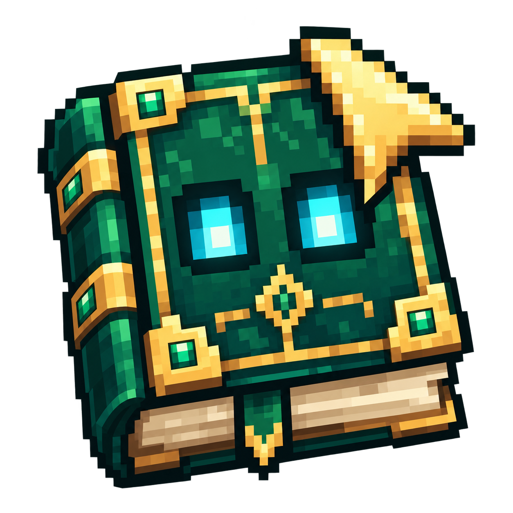

<h1 align="center">📗 Quest MCP</h1>

<p align="center">
  <strong>FTB Quests quest book · JEI recipe lookup · Local MCP server</strong>
</p>

<div align="center">
  
</div>
<br>

<div align="center">
  <a href="https://github.com/bling-yshs/quest-mcp/stargazers"></a>
  <a href="https://github.com/bling-yshs/quest-mcp/releases/latest"></a>
  <a href="https://github.com/bling-yshs/quest-mcp/releases"></a>
  <a href="https://github.com/bling-yshs/quest-mcp/blob/main/LICENSE"></a>
</div>
<br>

<p align="center">
  <a href="README.md">简体中文</a> | <b>English</b>
</p>

> [!IMPORTANT]
> This mod was made with AI. There is no promise of quality, and no guarantee that it works or will be maintained.

## ✨ Introduction

While playing a large modpack, you can just ask your AI:

- "Which quest should I do next?"
- "How do I finish this quest?" (the AI reads the quest you have open in the quest book)
- "How do I craft a steel ingot? Which machine do I need?"

Quest MCP runs a local MCP server inside the game client. Once an MCP client such as Claude Code, Codex or Cursor connects, it can read the quest and recipe data of **the game you are playing right now**, with no need to look things up on a wiki or send screenshots. All tools are read-only: they never change quest progress or act in the game.

## 🚀 Tools

**FTB Quests quest book**

| Tool | Purpose |
|---|---|
| `list_chapters` | List all chapters |
| `get_chapter` | Show the quests in a chapter |
| `get_quest` | Read a quest: description, tasks, rewards and prerequisites |
| `search_quests` | Search quests by text or item |
| `get_current_quests` | Quests in progress, quests ready to start, and quests one step from unlocking |
| `get_viewed_quest` | The quest you have open in the quest book |

**JEI items and recipes**

| Tool | Purpose |
|---|---|
| `search_items` | Search items and fluids |
| `get_item_info` | Item details: name, tooltip, tags and JEI information pages |
| `get_recipes` / `get_uses` | How an item is made / what it is used for |
| `list_categories` | List all recipe categories, including modded machines |
| `get_category_recipes` | Browse the recipes of one category |

**Other**: `get_status` tells whether the game is ready (in a world, with the quest book and JEI recipes loaded).

Item names and tooltips follow the game's current language.

## 🎮 Supported versions

| Minecraft | Loader | Dependencies |
|---|---|---|
| 1.20.1 | Forge 47.3.19+ | FTB Quests 2001.3.1+, JEI 15.0.0.12+ |
| 1.21.1 | NeoForge 21.1.238+ | FTB Quests 2101.1.36+, JEI 19.50.0.414+ |
| 26.1.2 | NeoForge 26.1.2+ | FTB Quests 26.1.2.1+, JEI 29.5.0.24+ |

Only needed on the client; servers do not need it.

## 📖 Usage

1. Put the mod and its dependencies in the `mods` folder, start the game and join a world.
2. The chat shows the MCP address (by default `http://127.0.0.1:25599/mcp`); click it to copy.
3. Add this address to your AI client, using the Streamable HTTP transport. For example, with Claude Code:

   ```sh
   claude mcp add --transport http quest-mcp http://127.0.0.1:25599/mcp
   ```

In-game commands:

- `/questmcp`: show the server and game status
- `/questmcp restart`: restart the MCP server

## ⚙️ Configuration

The config file is `config/questmcp-client.toml`:

| Option | Default | Description |
|---|---|---|
| `port` | `25599` | Port of the MCP server |
| `token` | empty | When set, AI clients must send the `Authorization: Bearer <token>` header, so that other programs on this computer cannot read the game data |
| `revealHiddenQuests` | `false` | Whether the AI may see hidden chapters and quests. Off by default to avoid spoilers; a modpack author can turn it on to see the whole quest book |

## 📄 License

This project is licensed under [GPL-3.0](LICENSE).
